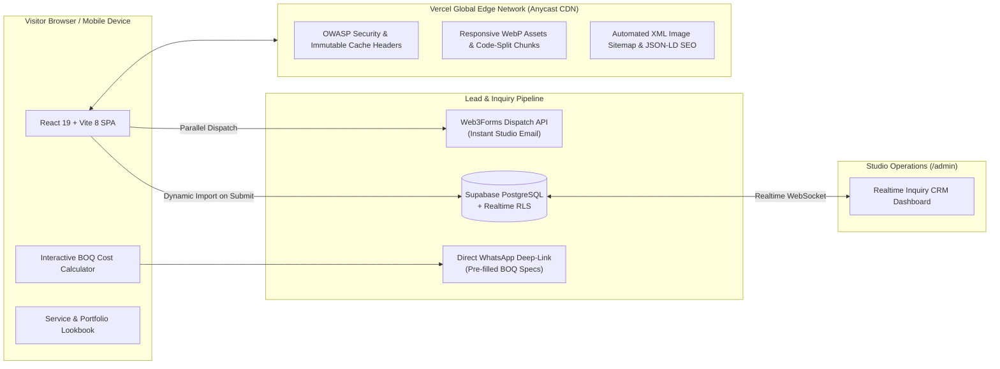

# Brown's Interior — Web Platform & Architecture

Official web platform, interactive BOQ cost estimator, design lookbook, and lead-management system for **Brown's Interior** ([www.brownsinterior.com](https://www.brownsinterior.com/)), a premier interior design, architectural planning, structural consultancy, and turnkey execution firm based in Dhaka, Bangladesh and serving clients worldwide.

---

## 1. System Overview & High-Level Architecture

The platform is engineered as a **high-performance, edge-cached React 19 Single-Page Application (SPA)** coupled with an isolated **Admin CRM Portal** (`/admin`) and a dual-channel inquiry pipeline (**Supabase PostgreSQL + Web3Forms Instant Email Dispatch**).



---

## 2. Tech Stack & Core Dependencies

| Layer | Technology | Purpose |
| :--- | :--- | :--- |
| **Runtime & UI** | **React 19.2** + **React Router 7** | Component architecture, client-side routing, and route-level `<Suspense>` boundaries |
| **Bundler & Compiler** | **Vite 8.3 (Rolldown)** + **Oxc** | Ultra-fast ESM bundling, deterministic vendor chunk splitting, and `oxlint` static analysis |
| **Motion & Interactions** | **Framer Motion 13** | Hardware-accelerated page transitions, interactive before/after scrubber, and scroll reveals |
| **Database & Realtime** | **Supabase (`@supabase/supabase-js`)** | PostgreSQL persistence (`public.inquiries`), Row-Level Security (RLS), and Realtime admin sync |
| **Notification Pipeline** | **Web3Forms REST API** | Zero-latency email notifications delivered to `info@brownsinterior.com` on every lead submission |
| **Media & Asset Pipeline** | **Python Pillow (`scripts/optimize-hero.py`)** | Automated multi-resolution WebP generation (`960w`, `1600w`, `2200w`) with Lanczos resampling |
| **SEO & Indexing** | **Custom `<SEO />` Engine + `generate-sitemap.mjs`** | Dynamic Open Graph / Twitter cards, Schema.org JSON-LD graph, and 55-route Google Image Sitemap |

---

## 3. Repository Structure

```text
brownsinterior/
├── index.html                  # Primary HTML entry, JSON-LD LocalBusiness graph, LCP preload hints
├── vite.config.js              # Rolldown manual chunking (vendor-react, vendor-motion, vendor-icons, vendor-supabase)
├── vercel.json                 # Edge routing rewrites, OWASP security headers, and immutable asset cache policies
├── public/
│   ├── optimized/hero/         # Responsive WebP hero slides (960w, 1600w, 2200w)
│   ├── portfolio/              # Categorized project photography & 3D renders (.webp + preserved originals)
│   ├── team/                   # Executive & engineering leadership portraits (.webp + originals)
│   ├── sitemap.xml             # Auto-generated Google URL + Image Sitemap (55 verified routes)
│   └── robots.txt              # Search crawler directives
├── scripts/
│   ├── generate-sitemap.mjs    # Pre-build script: introspects services, projects & blog data to build sitemap.xml
│   ├── generate-favicons.mjs   # Multi-device favicon & manifest generator
│   └── optimize-hero.py        # Non-destructive WebP encoding pipeline for hero, portfolio, and team imagery
├── src/
│   ├── main.jsx                # React 19 root mount wrapped in global ErrorBoundary
│   ├── App.jsx                 # Route table, React.lazy() code-splitting, and home storytelling sequence
│   ├── components/
│   │   ├── HomeSections.jsx    # Hero slideshow, Stats counter, Services grid, Before/After stage, Process, Testimonials
│   │   ├── Navbar.jsx          # Responsive header with on-demand desktop cascading mega-menu & mobile drawer
│   │   ├── ServicesPage.jsx    # Filterable discipline directory (7 core categories, 30+ specializations)
│   │   ├── ServiceDetail.jsx   # Dynamic category/sub-service template with interactive lookbook & lightbox
│   │   ├── ProjectsPage.jsx    # Editorial asymmetric portfolio showcase
│   │   ├── ProjectDetail.jsx   # Case study view with project metadata and gallery
│   │   ├── ExtraPages.jsx      # Dhaka-calibrated BOQ Cost Calculator, 6-Step Process Timeline, Blog & Testimonials
│   │   ├── BlogPost.jsx        # Long-form SEO article engine with rich-text parser, TOC, FAQs & Article JSON-LD
│   │   ├── About.jsx           # Studio story, Founder spotlight (Engr. Aslam Sheikh), and IEB credentials
│   │   ├── Team.jsx            # Leadership & execution specialist directory
│   │   ├── Contact.jsx         # Pre-fillable consultation form (syncs URL params from Cost Calculator & Services)
│   │   ├── FloatingContact.jsx # Quick-action WhatsApp / Phone / Email floating widget
│   │   └── SEO.jsx             # Per-route document title, canonical URL, Open Graph, and dynamic JSON-LD injector
│   ├── data/
│   │   ├── servicesData.js     # Hierarchical service tree (7 categories -> sub-services, specs, features, galleries)
│   │   ├── projectsData.js     # Completed turnkey residential, commercial & exhibition projects
│   │   ├── siteData.js         # Team directory, process steps, client testimonials, and lightweight blog previews
│   │   └── blogData.js         # Full-text SEO articles, structured sections, inline images, and FAQ schemas
│   ├── lib/
│   │   └── supabase.js         # Lazy-loaded Supabase client, Web3Forms dispatcher, and offline localStorage fallback
│   └── styles/
│       └── site.css            # Design tokens, claymorphism surfaces, typography scale, and content-visibility rules
├── supabase/
│   └── schema.sql              # PostgreSQL table definition, updated_at triggers, RLS policies, and Realtime config
└── admin/                      # Standalone Vite + React Admin CRM for managing inquiries across lifecycle stages
```

---

## 4. Performance & Core Web Vitals Architecture

The application is tuned to achieve **98–100 Performance, 100 Accessibility, 96–100 Best Practices, and 100 SEO** on Google Lighthouse:

1. **Zero-Latency LCP Discovery (`< 1.1s`):**
   * `index.html` preloads the primary hero WebP `srcSet` (`960w`, `1600w`, `2200w`) with `fetchpriority="high"`.
   * `HomeHero` renders a native `` with `fetchPriority="high"` and `decoding="sync"` on slide 0 without initial opacity delays.
2. **Route & SDK Code-Splitting:**
   * All secondary routes (`ServicesPage`, `ServiceDetail`, `ProjectsPage`, `ProjectDetail`, `BlogPost`, `ExtraPages`, `NotFound`) and below-the-fold sections (`Team`, `Contact`) are split via `React.lazy()`.
   * `@supabase/supabase-js` (`~209 KB`) is isolated into `vendor-supabase` and dynamically imported **only** when a user submits an inquiry form.
   * Lightweight `blogPreviews` in `siteData.js` are decoupled from the full 860-line `blogData.js` article bodies so the homepage never downloads full blog posts on initial load.
3. **Non-Blocking Font & CSS Pipeline:**
   * Google Fonts (`Playfair Display`, `Inter`, `Montserrat`, `Outfit`, `Italianno`) are consolidated into a single asynchronous preload tag in `index.html`.
   * Below-the-fold `.section` containers use `content-visibility: auto; contain-intrinsic-size: 1px 650px;` so the browser skips layout and paint work for offscreen sections until scrolled.
4. **On-Demand Mega-Menu DOM Mounting:**
   * The desktop cascading services flyout in `Navbar.jsx` mounts only when hovered/opened, saving ~350 DOM nodes and SVG icons on mobile devices.

---

## 5. Security & Edge Caching (`vercel.json`)

Every response served from the Vercel Edge Network includes strict OWASP security headers:

* `Strict-Transport-Security: max-age=63072000; includeSubDomains; preload` (2-year HSTS)
* `X-Content-Type-Options: nosniff`
* `X-Frame-Options: SAMEORIGIN`
* `Referrer-Policy: strict-origin-when-cross-origin`
* `Permissions-Policy: camera=(), microphone=(), geolocation=()`

Static hashed bundles (`/assets/*`) and responsive hero media (`/optimized/*`) are served with `Cache-Control: public, max-age=31536000, immutable`, while portfolio and team WebP assets use `stale-while-revalidate` edge caching.

---

## 6. Local Development & Build Workflow

### Prerequisites
* **Node.js** `>= 20.x` (v22 recommended)
* **Python 3 + Pillow** *(optional, only required when regenerating WebP assets via `scripts/optimize-hero.py`)*

### 1. Install Dependencies
```bash
npm install
```

### 2. Configure Environment Variables
Copy `.env.example` to `.env` and populate your credentials:
```bash
cp .env.example .env
```
```env
VITE_SUPABASE_URL=https://your-project-id.supabase.co
VITE_SUPABASE_ANON_KEY=your-supabase-anon-public-key
VITE_NOTIFICATION_EMAIL=info@brownsinterior.com
VITE_WEB3FORMS_KEY=your-web3forms-access-key
```
*(Note: If Supabase credentials are omitted during local development, `src/lib/supabase.js` gracefully falls back to `localStorage` + Web3Forms so inquiry flows remain 100% testable offline.)*

### 3. Run Development Server
```bash
npm run dev
```

### 4. Optimize New Portfolio / Hero Images (When Adding Media)
Place original `.jpg`/`.png` files in `public/portfolio/` or `public/team/`, then run:
```bash
python3 scripts/optimize-hero.py
```
*(Originals are preserved untouched; optimized `.webp` derivatives are generated alongside them.)*

### 5. Production Build & Sitemap Generation
```bash
npm run build
```
This automatically executes `scripts/generate-sitemap.mjs` (updating `public/sitemap.xml` with all 55 service, project, and blog URLs + image metadata) before running `vite build`.

### 6. Lint & Preview Production Bundle
```bash
npm run lint
npm run preview
```

---

## 7. Admin CRM Portal (`/admin`) & Database Setup

To set up the database and run the standalone Admin Dashboard:
1. Open your **Supabase Dashboard → SQL Editor** and execute [`supabase/schema.sql`](supabase/schema.sql) to create the `public.inquiries` table, automatic `updated_at` triggers, RLS policies, and Realtime publication.
2. Start the Admin Portal:
   ```bash
   cd admin
   cp .env.example .env
   npm install
   npm run dev
   ```
